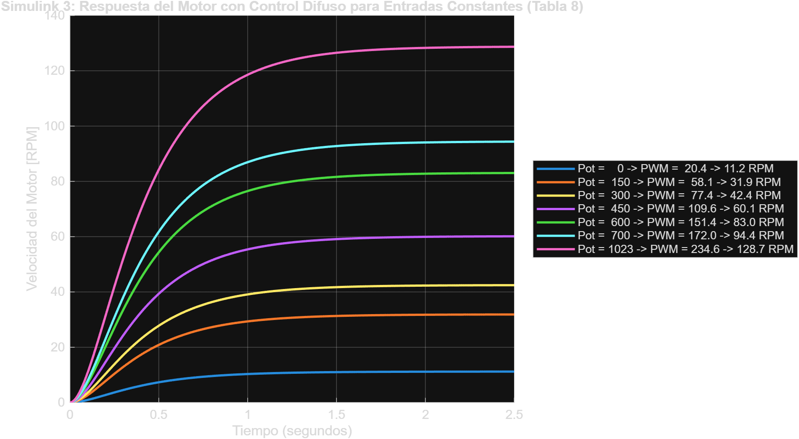

# Actividad 2: Control Difuso de Velocidad de un Motor de CD con Encoder (MATLAB, Simulink y Arduino UNO)

**Asignatura:** Control Avanzado | **Grupo:** MTR09C | **Profesora:** Dra. Anahí de Loera Figueroa  
**Universidad Politécnica de Aguascalientes (UPA)**

**Integrantes del equipo:**
- Rogelio Mota Herrera (`UP220086`)
- Juan Jesús Hernández Salas (`UP230061` - `up230061@alumnos.upa.edu.mx`)
- Luis André Amezcua Farías (`UP230727`)
- Santiago Javier Gallegos Macías Valadez (`UP220412`)
- Jennyfer Pamela López Rubalcaba (`UP230627`)

---

## 1. Selección de Tarjeta Microcontroladora (Separado por Carpeta: Arduino UNO 5V vs ESP32 DevKit 3.3V)

Para cumplir con las dos opciones del laboratorio (**"Arduino UNO o ESP32 DevKit"**), el repositorio está **separado claramente por tarjeta** sin borrar ningún archivo común:

| Tarjeta Microcontroladora | Carpeta Exclusiva en el Repositorio | Voltaje Lógico y Alimentación de Pot/Encoder | Escala ADC (Potenciómetro) | Pin Pot (ADC) | Pines Encoder (Fase A / B) | Pines Puente H (`ENA`, `IN1`, `IN2`) | Instalador Automático por CMD (`.bat`) | Manual Exclusivo |
| :--- | :--- | :---: | :---: | :---: | :---: | :---: | :--- | :--- |
| **TARJETA 1: Arduino UNO (`5V`)** | [`1_Tarjeta_Arduino_UNO_5V/`](1_Tarjeta_Arduino_UNO_5V/) *(y raíz)* | **$5.0\text{ V}$** (Pin `5V`) | **10 bits** (`0` a `1023` directo) | Pin **`A0`** | Pin **`2`** y Pin **`3`** (+ Pull-up $47\text{ k}\Omega$ a `5V`) | Pin **`~9`**, **`7`**, **`8`** | [`INSTALAR_Y_EJECUTAR_TODO_CMD.bat`](INSTALAR_Y_EJECUTAR_TODO_CMD.bat) | [`MANUAL_ARDUINO_UNO_5V.md`](1_Tarjeta_Arduino_UNO_5V/MANUAL_ARDUINO_UNO_5V.md) |
| **TARJETA 2: ESP32 DevKit V1 (`3.3V`)** | [`2_Tarjeta_ESP32_DevKit_3V3/`](2_Tarjeta_ESP32_DevKit_3V3/) | **$3.3\text{ V}$** (Pin `3V3` - **¡No usar 5V!**) | **12 bits** (`0` a `4095` escalado a `0–1023`) | **`GPIO 34`** (`D34`) | **`GPIO 18`** y **`GPIO 19`** (+ Pull-up $47\text{ k}\Omega$ a `3V3`) | **`GPIO 25`**, **`26`**, **`27`** | [`2_Tarjeta_ESP32_DevKit_3V3/INSTALAR_Y_EJECUTAR_ESP32_CMD.bat`](2_Tarjeta_ESP32_DevKit_3V3/INSTALAR_Y_EJECUTAR_ESP32_CMD.bat) | [`MANUAL_ESP32_DEVKIT_3V3.md`](2_Tarjeta_ESP32_DevKit_3V3/MANUAL_ESP32_DEVKIT_3V3.md) |

---

## 1.1 Estructura Completa del Repositorio y Dónde Colocar los Archivos para que el `.bat` Funcione

1. **Archivos Comunes de MATLAB R2023a y Simulink (Sirven para ambas tarjetas):**
   - **Sistema de Inferencia Difusa (`.fis`):** `ControlDifusoMotorDC.fis`
   - **Simulink 1 (Motor Sin Control / Lazo Abierto - Compatible R2023a):** `Simulink_1_Motor_Sin_Control.slx`
   - **Simulink 2 (Motor Con Control Proporcional LGR Continuo y Discreto ZOH - Compatible R2023a):** `Simulink_2_Motor_Con_Control.slx`
   - **Simulink 3 (Control Difuso Mamdani + Planta del Motor - Compatible R2023a):** `Simulink_3_Control_Difuso_Motor_Arduino.slx`
   - **Script Maestro de MATLAB (Generador y Simulador):** `generar_proyecto_fuzzy_motor.m`
2. **Carpeta Separada para TARJETA 1 — Arduino UNO (Lógica 5V):** [`1_Tarjeta_Arduino_UNO_5V/`](1_Tarjeta_Arduino_UNO_5V/)
   - Firmware `.ino` y `.hex` precompilado: `Arduino_Control_Difuso_MotorDC/Arduino_Control_Difuso_MotorDC.ino`
   - Script en vivo MATLAB $\leftrightarrow$ Arduino UNO: `conectar_arduino_matlab_fuzzy.m`
   - Lanzador automático `.bat`: `INSTALAR_Y_EJECUTAR_ARDUINO_UNO_CMD.bat` (también en la raíz como `INSTALAR_Y_EJECUTAR_TODO_CMD.bat`)
   - Manual exclusivo Arduino UNO 5V: [`1_Tarjeta_Arduino_UNO_5V/MANUAL_ARDUINO_UNO_5V.md`](1_Tarjeta_Arduino_UNO_5V/MANUAL_ARDUINO_UNO_5V.md)
3. **Carpeta Separada para TARJETA 2 — ESP32 DevKit V1 (Lógica 3.3V):** [`2_Tarjeta_ESP32_DevKit_3V3/`](2_Tarjeta_ESP32_DevKit_3V3/)
   - Firmware exclusivo ESP32 3.3V (con conversión ADC 12 bits `0–4095` a `0–1023`): [`2_Tarjeta_ESP32_DevKit_3V3/ESP32_Control_Difuso_MotorDC/ESP32_Control_Difuso_MotorDC.ino`](2_Tarjeta_ESP32_DevKit_3V3/ESP32_Control_Difuso_MotorDC/ESP32_Control_Difuso_MotorDC.ino)
   - Script en vivo MATLAB $\leftrightarrow$ ESP32: [`2_Tarjeta_ESP32_DevKit_3V3/conectar_esp32_matlab_fuzzy.m`](2_Tarjeta_ESP32_DevKit_3V3/conectar_esp32_matlab_fuzzy.m)
   - Lanzador MATLAB para ESP32: [`2_Tarjeta_ESP32_DevKit_3V3/iniciar_todo_matlab_esp32.m`](2_Tarjeta_ESP32_DevKit_3V3/iniciar_todo_matlab_esp32.m)
   - Instalador y compilador por CMD para ESP32: [`2_Tarjeta_ESP32_DevKit_3V3/INSTALAR_Y_EJECUTAR_ESP32_CMD.bat`](2_Tarjeta_ESP32_DevKit_3V3/INSTALAR_Y_EJECUTAR_ESP32_CMD.bat)
   - Manual exclusivo ESP32 DevKit 3.3V: [`2_Tarjeta_ESP32_DevKit_3V3/MANUAL_ESP32_DEVKIT_3V3.md`](2_Tarjeta_ESP32_DevKit_3V3/MANUAL_ESP32_DEVKIT_3V3.md)

### ¿Dónde tengo que poner las cosas para que `INSTALAR_Y_EJECUTAR_TODO_CMD.bat` jale todo?

El archivo `INSTALAR_Y_EJECUTAR_TODO_CMD.bat` utiliza rutas automáticas relativas (`%~dp0`), por lo que **puedes colocar la carpeta en cualquier lugar de la PC** (en el `Escritorio`, en `Documentos`, en `C:\ControlDifuso\` o en una memoria USB), **siempre y cuando todos los archivos del repositorio permanezcan juntos dentro de esa misma carpeta**:

```text
📁 Control-Difuso-Velocidad-Motor-DC/   <-- (Puedes poner esta carpeta en Escritorio, Documentos, C:\, etc.)
 ├── ⚙️ INSTALAR_Y_EJECUTAR_TODO_CMD.bat          <-- ¡A ESTE LE DAS DOBLE CLIC!
 ├── 📄 iniciar_todo_matlab_arduino.m
 ├── 📄 generar_proyecto_fuzzy_motor.m
 ├── 📄 conectar_arduino_matlab_fuzzy.m
 ├── 📄 ControlDifusoMotorDC.fis
 ├── 📄 Simulink_1_Motor_Sin_Control.slx
 ├── 📄 Simulink_2_Motor_Con_Control.slx
 ├── 📄 Simulink_3_Control_Difuso_Motor_Arduino.slx
 └── 📁 Arduino_Control_Difuso_MotorDC/           <-- (Esta subcarpeta debe quedarse ahí adentro)
      ├── 📄 Arduino_Control_Difuso_MotorDC.ino
      └── 📁 build/
           └── 📄 Arduino_Control_Difuso_MotorDC.ino.hex
```

#### Pasos rápidos para correr el `.bat` en cualquier otra PC:
1. **Extraer el ZIP completo:** Si descargaste el repositorio desde GitHub como `.zip`, dale **Clic derecho $\rightarrow$ Extraer todo...** (no ejecutes el `.bat` desde adentro del `.zip` sin descomprimirlo, ni saques el `.bat` suelto fuera de la carpeta).
2. **Conectar el Arduino UNO por USB:** Enchufa el cable USB del Arduino UNO a la PC antes de correr el `.bat` para que detecte el puerto `COM` y suba el código `.ino`/`.hex` automáticamente.
3. **Ejecutar el `.bat`:** Dale **doble clic a `INSTALAR_Y_EJECUTAR_TODO_CMD.bat`** (o *Clic derecho $\rightarrow$ Ejecutar como administrador* si es la primera vez que se instala `arduino-cli` en esa PC).

---

## 2. Manual de Conexión Física (Arduino UNO + Puente H + Motor GM25-370 Encoder + Potenciómetro)

> **Regla de oro antes de energizar:** Arma todo el circuito con la **fuente de alimentación de 12 V apagada** y el Arduino desconectado del USB. Verifica que el **GND de la fuente de 12 V, el GND del Puente H y el GND del Arduino UNO estén unidos en un nodo común**.

### 2.1 Referencia Visual de los Componentes

| Pizarrón de Laboratorio | Pinout Motor GM 25-370 Encoder | Módulo Puente H (L298N) |
| :---: | :---: | :---: |
|  |  |  |

### 2.2 Tabla Maestra de Conexiones Paso a Paso

#### A) Conexión del Motor GM 25-370 (6 cables del conector blanco)

| Pin / Color en el Motor GM 25-370 | Función del Cable | ¿A dónde se conecta? | Notas de Instalación |
| :--- | :--- | :--- | :--- |
| **Rojo (`M1 Motor -`)** | Terminal de potencia del motor (-) | **Bornera `Entrada Motor 1` (OUT1)** del Puente H | Si el motor gira al revés de lo deseado, invierte los cables Rojo y Blanco en la bornera del Puente H. |
| **Blanco (`M1 Motor +`)** | Terminal de potencia del motor (+) | **Bornera `Entrada Motor 1` (OUT2)** del Puente H | Recibe los 0–12 V modulados por PWM desde el Puente H. |
| **Negro (`GND Encoder`)** | Tierra lógica del sensor Hall/Óptico | **Pin `GND`** del Arduino UNO (Protoboard GND) | Debe compartir tierra con el Arduino UNO. |
| **Azul (`3.3V/5V Encoder +`)** | Alimentación lógica del encoder | **Pin `5V`** del Arduino UNO (Protoboard +5V) | **¡NUNCA conectar a los 12 V!** Se alimenta estrictamente con `5V` del Arduino. |
| **Amarillo (`Fase A Encoder`)** | Señal de pulsos Canal A (Tacómetro) | **Pin Digital `2`** del Arduino UNO (`INT0`) | **Colocar la resistencia pull-up de $47\text{ k}\Omega$** entre este cable Amarillo (Pin 2) y la línea de `5V` del Arduino. |
| **Verde (`Fase B Encoder`)** | Señal de cuadratura Canal B | **Pin Digital `3`** del Arduino UNO (`INT1`) | Permite detectar dirección y contar pulsos en cuadratura. |

#### B) Conexión del Módulo Puente H (L298N / Driver de Potencia)

| Terminal en el Puente H | ¿A dónde se conecta? | Explicación Técnica |
| :--- | :--- | :--- |
| **`ENA` (Jumper para activar Motor 1)** | **Retirar el jumper negro** y conectar el pin superior `ENA` al **Pin Digital `9` (`~PWM`)** del Arduino UNO | Al quitar el jumper, el pin `9` del Arduino inyecta la señal PWM (`0–255`) calculada por el Controlador Difuso. |
| **`IN1` (Entrada 1)** | **Pin Digital `7`** del Arduino UNO | Control de giro (`HIGH` = sentido horario). |
| **`IN2` (Entrada 2)** | **Pin Digital `8`** del Arduino UNO | Control de giro (`LOW` = sentido horario). |
| **`Voltaje de entrada` (+12V / VMS)** | **Terminal Positiva (`+`) de la Fuente de Laboratorio ajustada a `12 V` (o hasta 18 V máx.)** | Alimenta la etapa de potencia del motor. |
| **`GND` (Bornera central del Puente H)** | **Terminal Negativa (`-`) de la Fuente de 12 V** **Y TAMBIÉN** a un pin **`GND` del Arduino UNO** | **¡Indispensable!** Tierra común entre fuente de potencia y microcontrolador. |
| **`Jumper del Regulador`** | Dejar puesto el jumper central | Si alimentas el Arduino por cable USB desde la PC para usar MATLAB/Simulink, **NO conectes** la bornera `5v de Salida` del Puente H al pin `5V` del Arduino. |

#### C) Conexión del Potenciómetro de $10\text{ k}\Omega$ (Referencia de Velocidad) — Para TARJETA 1: Arduino UNO (`5V`)

| Pin del Potenciómetro ($10\text{ k}\Omega$) | ¿A dónde se conecta en el Arduino UNO (`5V`)? | Función |
| :--- | :--- | :--- |
| **Pin Extremo Izquierdo (Terminal 1)** | **`GND`** (Tierra común en Protoboard) | Referencia mínima ($0\text{ V} \rightarrow \text{ADC}_{10\text{b}} = 0$). |
| **Pin Central (Cursor / Wiper)** | **Pin Analógico `A0`** del Arduino UNO | Señal de entrada al Controlador Difuso (`Pot`: `0` a `1023`). |
| **Pin Extremo Derecho (Terminal 3)** | **`5V`** del Arduino UNO | Referencia máxima ($5\text{ V} \rightarrow \text{ADC}_{10\text{b}} = 1023$). |

---

### 2.3 Conexión Física Exclusiva para TARJETA 2: ESP32 DevKit V1 (Lógica de $3.3\text{ V}$)
*(Ver manual completo en [`2_Tarjeta_ESP32_DevKit_3V3/MANUAL_ESP32_DEVKIT_3V3.md`](2_Tarjeta_ESP32_DevKit_3V3/MANUAL_ESP32_DEVKIT_3V3.md))*

> **¡IMPORTANTE PARA ESP32 (3.3V)!** Los pines del ESP32 trabajan a **$3.3\text{ V}$** (no toleran $5\text{ V}$). Por lo tanto, el **Potenciómetro**, el **Cable Azul del Encoder (`3.3V/5V Encoder +`)** y la **Resistencia Pull-Up de $47\text{ k}\Omega$** se conectan al pin **`3V3` ($3.3\text{ V}$) del ESP32**. Además, el ADC del ESP32 es de **12 bits (`0` a `4095` para `0–3.3 V`)**, y el firmware [`ESP32_Control_Difuso_MotorDC.ino`](2_Tarjeta_ESP32_DevKit_3V3/ESP32_Control_Difuso_MotorDC/ESP32_Control_Difuso_MotorDC.ino) lo escala automáticamente a `0–1023`.

| Componente / Cable | Pin en TARJETA 2: ESP32 DevKit V1 (`3.3V`) | Notas de Adaptación a $3.3\text{ V}$ |
| :--- | :--- | :--- |
| **Potenciómetro Pin Central (Cursor)** | **`GPIO 34` (`D34` / `ADC1_CH6`)** | Entrada analógica de 12 bits (`0–4095` a $3.3\text{ V}$ $\rightarrow$ escalado a `0–1023`). |
| **Potenciómetro Extremos (Pin 1 y Pin 3)** | **`GND`** y **`3V3` ($3.3\text{ V}$)** | **¡Conectar extremo positivo a `3V3`, nunca a `5V`!** |
| **Motor Cable Amarillo (`Fase A Encoder`)** | **`GPIO 18` (`D18`)** | Con **Resistencia Pull-Up de $47\text{ k}\Omega$ hacia `3V3` ($3.3\text{ V}$)**. |
| **Motor Cable Verde (`Fase B Encoder`)** | **`GPIO 19` (`D19`)** | Entrada digital de cuadratura a $3.3\text{ V}$. |
| **Motor Cable Azul (`3.3V/5V Encoder +`)** | **`3V3` ($3.3\text{ V}$)** del ESP32 | Alimenta el encoder a $3.3\text{ V}$ para que entregue pulsos seguros de $3.3\text{ V}$. |
| **Motor Cable Negro (`GND Encoder`)** | **`GND`** del ESP32 | Tierra común. |
| **Puente H Pin `ENA` (Sin jumper)** | **`GPIO 25` (`D25`)** | Salida PWM de 8 bits (`0–255`) generada por el ESP32. |
| **Puente H Pines `IN1` e `IN2`** | **`GPIO 26` (`D26`)** y **`GPIO 27` (`D27`)** | Control de dirección (`IN1 = HIGH`, `IN2 = LOW`). |
| **Puente H Bornera `GND`** | **`GND` de Fuente 12V + `GND` del ESP32** | Tierra común obligatoria entre Fuente 12V, Puente H y ESP32. |

---

## 3. Parte A: Diseño del Controlador Difuso (Mamdani) en MATLAB

- **Tipo de Sistema Difuso:** Mamdani (`mamfis`)
- **Método de intersección (AND):** Mínimo (`min`)
- **Método de implicación:** Mínimo (`min`)
- **Método de agregación:** Máximo (`max`)
- **Método de defuzzificación:** Centroide ($y = \frac{\int y \cdot \mu(y)\,dy}{\int \mu(y)\,dy}$)

### 3.1 Variables Lingüísticas y Funciones de Membresía

#### 1. Variable de Entrada: `Pot` (Lectura del Potenciómetro, Rango $[0, 1023]$)

| Conjunto Difuso | Identificador en `.fis` | Tipo | Vértices $[a,\; b,\; c]$ |
| :--- | :--- | :--- | :--- |
| **Baja** | `Baja` | `trimf` | $[-255.75,\; 0.00,\; 255.75]$ |
| **Media baja** | `Media_baja` | `trimf` | $[0.00,\; 255.75,\; 511.50]$ |
| **Media** | `Media` | `trimf` | $[255.75,\; 511.50,\; 767.25]$ |
| **Media alta** | `Media_alta` | `trimf` | $[511.50,\; 767.25,\; 1023.00]$ |
| **Alta** | `Alta` | `trimf` | $[767.25,\; 1023.00,\; 1278.75]$ |

#### 2. Variable de Salida: `Velocidad_PWM` (Señal PWM, Rango $[0, 255]$)

| Conjunto Difuso | Identificador en `.fis` | Tipo | Vértices $[a,\; b,\; c]$ |
| :--- | :--- | :--- | :--- |
| **Lenta** | `Lenta` | `trimf` | $[-63.75,\; 0.00,\; 63.75]$ |
| **Media lenta** | `Media_lenta` | `trimf` | $[0.00,\; 63.75,\; 127.50]$ |
| **Media** | `Media` | `trimf` | $[63.75,\; 127.50,\; 191.25]$ |
| **Media Veloz** | `Media_Veloz` | `trimf` | $[127.50,\; 191.25,\; 255.00]$ |
| **Veloz** | `Veloz` | `trimf` | $[191.25,\; 255.00,\; 318.75]$ |

### 3.2 Base de 5 Reglas de Inferencia (Mamdani)

1. `IF (Pot is Baja) THEN (Velocidad_PWM is Lenta) (1)`
2. `IF (Pot is Media_baja) THEN (Velocidad_PWM is Media_lenta) (1)`
3. `IF (Pot is Media) THEN (Velocidad_PWM is Media) (1)`
4. `IF (Pot is Media_alta) THEN (Velocidad_PWM is Media_Veloz) (1)`
5. `IF (Pot is Alta) THEN (Velocidad_PWM is Veloz) (1)`

### 3.3 Gráficas del Sistema Difuso


---

## 4. Parte B: Los 3 Modelos en Simulink

Función de transferencia de la planta obtenida experimentalmente:
$$G_p(s) = \frac{\Omega(s)}{V(s)} = \frac{24}{s^2 + 11s + 24} = \frac{24}{(s+3)(s+8)}$$
Con controlador proporcional sintonizado por LGR ($\text{OS} = 20\%$): $K = 5.0629$, y discretización ZOH ($T = 0.04\text{ s}$):
$$G_p(z) = \frac{0.016617z + 0.014351}{z^2 - 1.613069z + 0.643936}$$




---

## 5. Tabla de Resultados (Punto 8 del Reporte)

| `pot` (0–1023) | `pwm` MATLAB (`evalfis`) | `pwm` Simulink | `pwm` hardware (Arduino 8 bits) | $\omega_{ss}$ Motor ($\text{rad/s}$) | `RPM medidas` (Simulink / Nominal GM25-370) | `RPM medidas` estimadas en Hardware Físico |
| :---: | :---: | :---: | :---: | :---: | :---: | :---: |
| **0** | `20.40` | `20.40` | `20` | `0.96 rad/s` | `11.19 RPM` | `0.0 RPM` *(Zona muerta < 35 PWM)* |
| **150** | `58.07` | `58.07` | `58` | `2.73 rad/s` | `31.85 RPM` | `~26.5 RPM` |
| **300** | `77.38` | `77.38` | `77` | `3.64 rad/s` | `42.45 RPM` | `~39.0 RPM` |
| **450** | `109.62` | `109.62` | `110` | `5.15 rad/s` | `60.13 RPM` | `~58.2 RPM` |
| **600** | `151.37` | `151.37` | `151` | `7.12 rad/s` | `83.03 RPM` | `~81.5 RPM` |
| **700** | `172.04` | `172.04` | `172` | `8.09 rad/s` | `94.37 RPM` | `~93.0 RPM` |
| **1023** | `234.60` | `234.60` | `235` | `11.03 rad/s` | `128.69 RPM` | `~126.0 RPM` |
